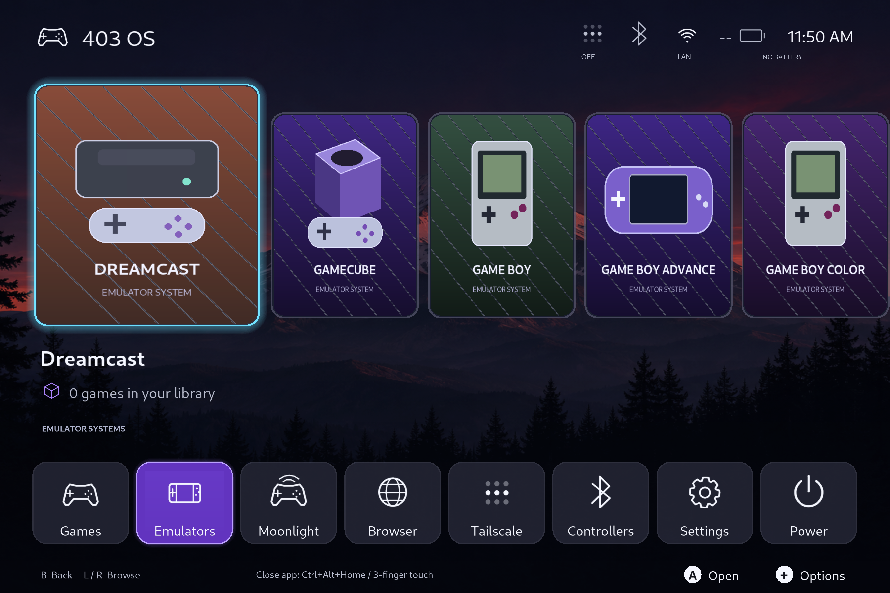
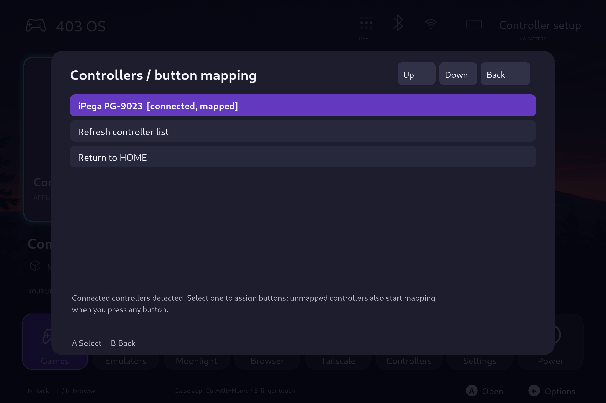
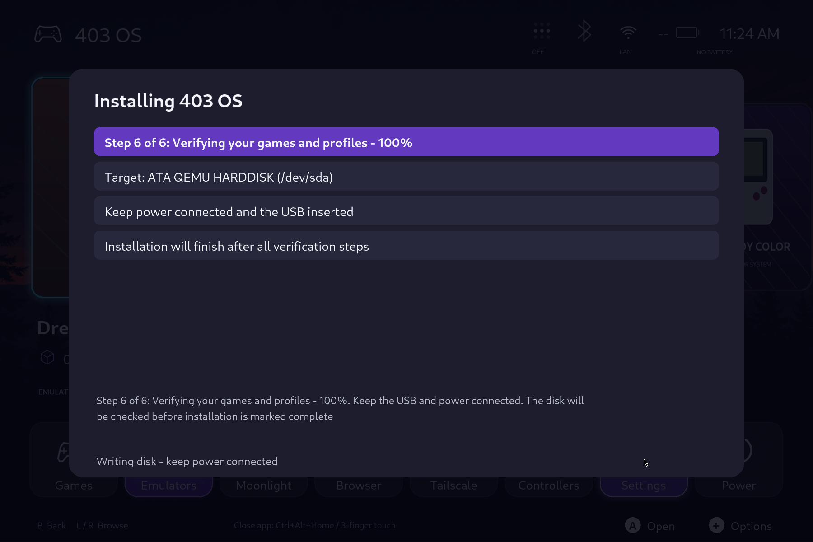
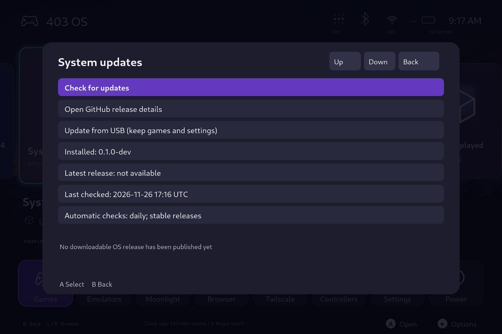

# 403 OS

A controller-first Linux gaming OS for Microsoft Surface Go, with a native
C++/SDL3 interface for games, emulators, streaming and system settings.

*Actual HOME interface in QEMU. Game artwork appears when a library is added.*

*Actual emulator browser with the included original system artwork.*

## Features

- Automatically find games in local storage and connected game drives; search
  by title, browse systems, and keep cover art, favorites and play history.
- Eleven bundled emulator engines: FCEUmm, Snes9x, Gambatte, mGBA,
  Genesis Plus GX, PCSX ReARMed, Mupen64Plus Next, melonDS DS, Flycast,
  PPSSPP and Dolphin.
- Moonlight streaming, Tailscale, a WebKit browser and Wine64/UMU integration.
- Gamepad, keyboard and touch navigation, with audio, network and display controls.
- USB/Bluetooth controller drivers and automatic SDL button profiles, with an
  optional mapping wizard for custom controls.
- Bluetooth PIN/passkey prompts and power-button tap-to-sleep while using apps.
- Password-protected profiles, a first-run root administrator and separate user app identities.
- Display resolution trials and sensor-driven rotation of the internal screen.
- Live USB and an internal-storage installer that carries over local games,
  saves, settings and password-protected profiles from the live USB.
- Update an existing installation from USB while keeping its games, saves,
  profiles, passwords and settings, with a verified system recovery copy.
- Check GitHub for new stable OS releases in **Settings → System updates**.

*Controller mapping running in QEMU with a simulated iPega controller.
Physical Surface Bluetooth compatibility still requires device testing.*

Supply your own games and required BIOS files. Public builds contain no personal
or commercial ROMs, commercial game artwork, proprietary clients or account
credentials. An original MIT-licensed NES test cartridge is included for diagnostics.

Put local games in `/data/roms`, or connect a supported USB/SD game drive.
HOME updates automatically. Open **Games → Search games** to search titles or
choose **Find games** to refresh; downloading missing covers is a separate
action. Connected game drives are mounted read only.

Installing erases the selected internal disk. The installer then copies and
verifies supported live-USB DATA, including local games, saves and profiles;
keep using the same profile passwords after installation. Files already on the
target disk need a separate backup. External game drives remain separate.

## Getting started

403 OS is currently available as source. No downloadable OS release has been
published yet. Follow the [build guide](docs/BUILD.md) to create the persistent
live USB image, `output/images/surface-go.img`.

Write the image with an image writer to the intended USB. Writing erases that
USB. Boot it in UEFI mode with Secure Boot disabled. Create your own
administrator password at first startup.
For a fresh installation, choose **Install 403 OS** and carefully review the
target disk before confirming erasure. Choose **Finish and power off** when
installation completes, remove the media, then start from internal storage.

Use the persistent USB image for updates: it retains the recovery copy after
shutdown. Experimental ISO support is included in the source, but installation
testing is not yet complete. ISO live settings are temporary, and the ISO does
not support updating an existing installation. The in-system update checker
will list stable GitHub releases when they become available.

[Installation and recovery](docs/INSTALL_RECOVERY.md) ·
[System updates](docs/UPDATES.md) ·
[Controllers and Bluetooth](docs/BLUETOOTH.md) ·
[Sleep and power button](docs/POWER.md) ·
[Remote play](docs/REMOTE_PLAY.md) ·
[Windows applications](docs/WINDOWS_COMPATIBILITY.md) ·
[Build from source](docs/BUILD.md)

**Development preview.** VM boot and runtime checks cover the included
components; they do not establish performance or compatibility on Surface
hardware. Surface touchscreen, accelerometer, Bluetooth pairing and individual
controller models still require physical testing.
See [status](docs/STATUS.md),
[roadmap](docs/ROADMAP.md) and [test results](docs/VM_TEST_REPORT.md).

Original project code is MIT licensed. Dependencies retain their own licenses;
see [third-party notices](THIRD_PARTY_NOTICES.md).
