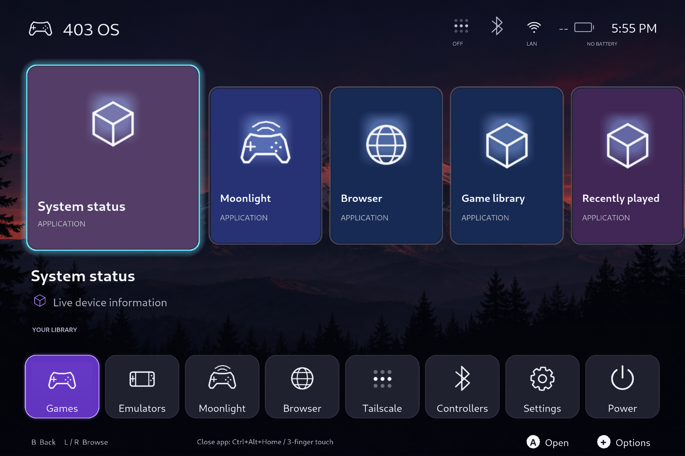

# 403 OS

A controller-first Linux gaming OS for the first-generation Microsoft Surface
Go. An original C++/SDL3 HOME interface brings your game library, emulators,
streaming apps and system settings together without a conventional desktop.



*Actual HOME interface running in QEMU at 1800×1200. Original artwork and an
empty library; no commercial game assets are included.*

**Development preview.** Earlier images pass VM installation and runtime
checks. The current self-contained installer and display controls are still
under validation. Surface hardware support is unverified. See
[status](docs/STATUS.md) and the [VM report](docs/VM_TEST_REPORT.md).

## Included

- Game library with system browsing, search, artwork support, favorites,
  history, save RAM and supported save states.
- Eleven emulator engines covering twelve systems, including GameCube through
  standalone Dolphin. Performance and game compatibility vary.
- Cog/WPE WebKit browser, Moonlight Embedded and Tailscale, launched or managed
  through HOME. Streaming and enrollment require your own authorized hosts.
- Wi-Fi, Bluetooth controller, audio, brightness, storage and power settings.
- Official PokeMMO first-run setup, user-supplied Digimon World 3 Online import,
  and Wine64/UMU Windows application controls. Proton setup is explicit.
- Self-contained live USB with a separate pristine installation image.

| System | Engine |
| --- | --- |
| NES | FCEUmm |
| SNES | Snes9x |
| Game Boy / Game Boy Color | Gambatte |
| Game Boy Advance | mGBA |
| Mega Drive / Genesis | Genesis Plus GX |
| PlayStation | PCSX ReARMed |
| Nintendo 64 | Mupen64Plus Next |
| Nintendo DS | melonDS DS |
| Dreamcast | Flycast |
| PSP | PPSSPP |
| GameCube | Dolphin |

Supply your own legally obtained games and any required BIOS files. ROMs,
console firmware, proprietary clients, credentials and commercial artwork
are not bundled. See [Windows compatibility](docs/WINDOWS_COMPATIBILITY.md)
and [remote PC setup](docs/REMOTE_PLAY.md).

## Build and try it

Use a Linux host with rootless Podman, a systemd user session, Git, curl, tar,
Python 3 and a C++20 compiler. VM tests also need QEMU/KVM and unsigned OVMF
firmware. The pinned container supplies image-build dependencies.

```sh
git clone https://github.com/HelloSpaghettiBot/403OS.git
cd 403OS
export SURFACE_DOWNLOADS="${XDG_CACHE_HOME:-$HOME/.cache}/403os/downloads"
scripts/test.sh
scripts/build.sh
scripts/vm-create.sh --visible
```

The initial build downloads several GB and can take hours. Builds run one at
a time with ten workers, a 24 GiB memory throttle, 32 GiB hard/container caps
and 1 GiB swap. VM host memory is capped at 6 GiB. Check available storage
before building; incremental builds reuse the download cache and `output/`.
Use `--ovmf /path/to/OVMF_CODE.fd` if firmware is installed elsewhere.

| Output under `output/images/` | Purpose |
| --- | --- |
| `surface-go.img` | Bootable USB image, including its installation payload |
| `surface-go-base.img` | Pristine image copied to internal storage |
| `SHA256SUMS` | Separate checksums for both images |
| `installer-media.json` | Packaging identities and payload-readback result |

Verify the checksums before use:

```sh
(cd output/images && sha256sum -c SHA256SUMS)
```

Write **`surface-go.img`** with an image-writing tool to a USB you have selected
by model and capacity. The operation erases all partitions and files on that
USB. Live-boot it before considering installation. The internal installer
finds its embedded payload automatically; no second USB or manual staging is
required. **Install to internal storage erases the selected disk**, requires
review and an exact typed confirmation, and expands the fresh DATA partition.
Read [installation, backup and recovery](docs/INSTALL_RECOVERY.md) first.
This unsigned development image requires Secure Boot to be disabled.

## Controls and display

| Action | Keyboard | Gamepad |
| --- | --- | --- |
| Navigate | Arrow keys | D-pad / shoulder buttons |
| Select / back | Enter / Escape | A / B |
| HOME quick controls | Tab | Guide / Start |
| Favorites / details | F / O | North / West button |

Touch navigation is implemented; physical Surface touch remains untested.
Ctrl+Alt+Home or a three-finger touch closes the active app with an exit/save
grace and returns HOME. Cog also closes with Ctrl+W.

Settings → **Display resolution** lists detected output modes and
native/preferred mode. Apply restarts HOME and the compositor for a
45-second trial. **Keep** saves the setting; timeout restores the previous
mode. This new flow is still under runtime validation. Moonlight's stream
resolution is configured separately.

## Tested scope

A preceding image passed guarded 64 GiB VM installation, DATA growth, three
detached UEFI boots, a 3 GiB/AHCI profile, network checks, browser/HOME return,
eleven engine probes, real NES homebrew input/SRAM reload, Wine command exit
and non-silent audio. VM results remain **PARTIAL** for hardware and external
services. The revised installer/display image needs its own complete checks.

Surface graphics, Type Cover, touchscreen, speakers, radios, battery and
suspend/resume remain unverified. Streaming, Proton setup and online-game
login/gameplay are not established by binary probes. This source repository
is not a finished OS release.

Original project code is MIT licensed; dependencies retain their own licenses.
See [third-party notices](THIRD_PARTY_NOTICES.md) and generate Buildroot
`legal-info` before distributing an image.
